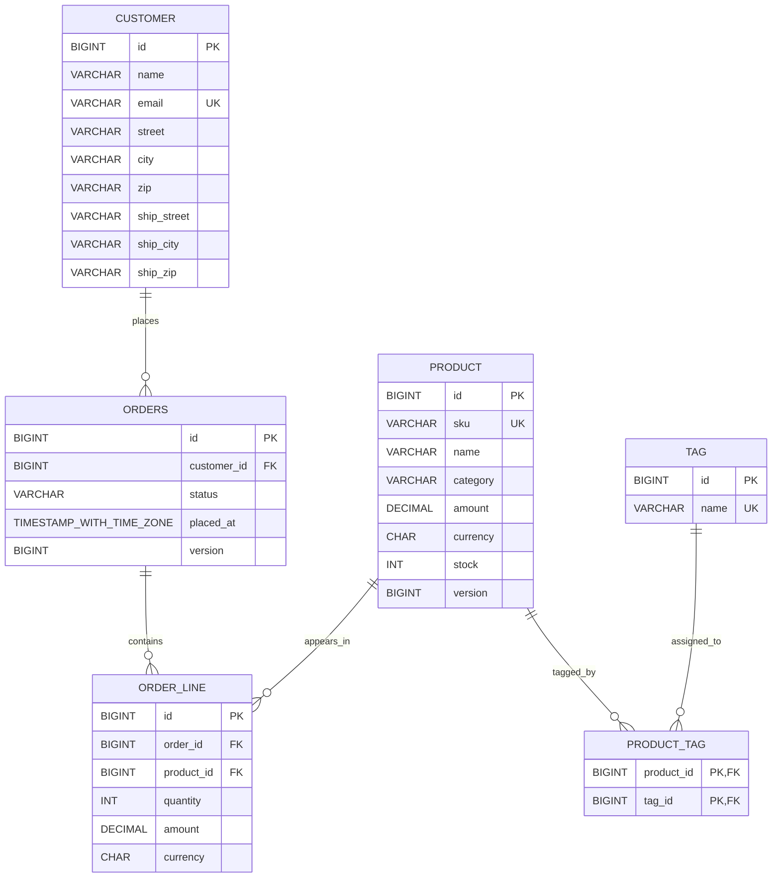

# Lab 3: Hibernate framework and Spring Data JPA

Spring Boot 4.1.1 · Java 21 · Maven · JdbcClient · H2 (default) / PostgreSQL (`prod`)

## Project structure

The code is organised **by feature**: each business area has its own package, plus a few cross-cutting packages.

```
shop-spring-boot
├── pom.xml
├── mvnw, mvnw.cmd
├── docker-compose.yml          PostgreSQL for the prod profile
├── .env.example                template for DB_PASSWORD
├── api-session.md              recorded API session
├── screenshots/
└── src
    ├── main
    │   ├── java/edu/itc/shop
    │   │   ├── ShopApplication.java
    │   │   ├── product/        products: entity, service, repositories, REST + JSP controllers, DTOs
    │   │   ├── order/          orders: entity, service, repository, REST controller, DTOs
    │   │   ├── notification/   Notifier and its Email / SMS / Console implementations
    │   │   ├── audit/          @Audited, AuditAspect, TimingAspect, RequestContext
    │   │   ├── config/         properties, health indicator, start-up runners
    │   │   └── common/         exception handler, request-id filter
    │   ├── resources           application*.yml, schema.sql, data*.sql, static/
    │   └── webapp/WEB-INF/jsp  JSP views
    └── test/java/edu/itc/shop  product/, order/, notification/ (mirrors main)
```

## Quick start

```powershell
.\mvnw.cmd spring-boot:run                                      # default profile: in-memory H2
.\mvnw.cmd spring-boot:run "-Dspring-boot.run.profiles=dev"     # dev: H2 console + DEBUG logging
.\mvnw.cmd clean verify                                         # run all tests (JDK 21 or newer)
```

## Contents

1. 
2. 
3. 
4. 
5. 
6.

---

## Task 2: Associations, cascading and entity identity

### What was added

- `Order.lines`: `@OneToMany(mappedBy = "order", cascade = ALL, orphanRemoval = true)` with the helpers `addLine`, `removeLine` and `total()`.
- `Product` ↔ `Tag` many-to-many through `product_tag` (`Product` is the owning side, `Tag` is the inverse side), with `Product.tag(Tag)` updating both sides.
- Hand-written `equals`, `hashCode` and `toString` on `Customer`, `Product`, `Tag`, `Order` and `OrderLine`.
- `OrderCascadeTest` (2 tests) and `EntityIdentityTest` (3 tests).

### How to run the tests

```bash
mvnw test -Dtest=OrderCascadeTest,EntityIdentityTest
```

Expected: `Tests run: 5, Failures: 0, Errors: 0` and `BUILD SUCCESS`.

To see only the SQL lines and the summary:

```bash
mvnw test -Dtest=OrderCascadeTest,EntityIdentityTest | findstr /C:"Hibernate: insert into orders" /C:"Hibernate: insert into order_line" /C:"Hibernate: delete from" /C:"Hibernate: update" /C:"Tests run" /C:"BUILD"
```

### Persist cascade

Only `em.persist(order)` was called. The lines were saved by the cascade:

```
insert into orders (customer_id,placed_at,status,version,id) values (?,?,?,?,?)
insert into order_line (order_id,product_id,quantity,amount,currency,id) values (?,?,?,?,?,?)
insert into order_line (order_id,product_id,quantity,amount,currency,id) values (?,?,?,?,?,?)
```

1 insert for the order + 2 for its lines, and no `update` statements.

### Orphan removal

`order.removeLine(...)` + `flush()` produced one delete:

```
delete from order_line where id=?
```

### Cascade REMOVE

`em.remove(order)` + `flush()` deleted the remaining line first, then the order:

```
delete from order_line where id=?
delete from orders where id=? and version=?
```

### Entity identity

- `equals` is true when both objects have the same class and the same non-null id.
- `hashCode` returns a constant per class, so a new `Product` put in a `HashSet` is still found after `persist` gives it an id.

# Challenge: — Reporting and Bulk Module
```Test 
.\mvnw.cmd -q test -Dtest=StockReservationTest,BulkImportTest 
```
## A. Feature overview

This module uses the existing `edu.itc.shop.domain` JPA model and Flyway schema; the older JDBC product/order endpoints remain in place.

| Feature | Endpoint / entry point |
|---|---|
| Criteria product report | `GET /api/reports/products` |
| Slice order feed | `GET /api/orders/feed?size=20&after=<placedAt>,<id>` |
| Keyset-scroll order feed | `GET /api/orders/feed/keyset?size=20&after=<placedAt>,<id>` |
| Stock reservation variants | `StockService.reserve`, `reserveOptimistically`, `reserveAtomically` |
| Bulk product import | `BulkImportService.importCsv(Path)`; benchmark variants are `importWithSaveAll` and `importWithSaveAllAndFlushClear` |

Example report request:

```text
GET /api/reports/products?category=HARDWARE&minStock=1&tag=sale&sort=amount,desc
```

The report item shape is:

```json
{"sku":"KB-7","name":"Mechanical keyboard","amount":129.00,"stock":4,"tagCount":2}
```

Example feed response:

```json
{
  "items": [{"id": 1187, "placedAt": "2026-09-20T08:11:02.331Z", "status": "NEW"}],
  "nextCursor": "2026-09-20T08:11:02.331Z,1187",
  "hasNext": true
}
```

## B. Database schema

The diagram reflects the entity mappings and Flyway migrations `V1` through `V3`. `PRODUCT.version` is added for optimistic locking, and `idx_orders_placed_at_id` supports the order-feed sort.



`PRODUCT_TAG` has a composite primary key `(product_id, tag_id)`. `Customer.billing` maps to `street/city/zip`; `Customer.shipping` maps to the `ship_*` columns.

## C. Criteria API product report

`ProductReportRepositoryImpl` builds Criteria API predicates for `q` (case-insensitive name or SKU), `category`, `maxPrice`, `minStock`, and `tag`. Empty filters omit the `WHERE` clause. The tag association is joined in the outer query only when `tag` is present; a correlated count subquery still reports each product's total tags. The query is distinct to prevent duplicates from the filter join.

`Product_` and `Money_` are generated by Hibernate's annotation processor during Maven compilation. The projection is created with `cb.construct(ProductReportRow.class, ...)`, grouped by product fields and tag count. Sort keys are limited to `sku`, `name`, `amount`, `stock`, and `tagCount`; direction is only `asc` or `desc`. Unrecognized values return HTTP 400 and are never interpreted as an entity path or SQL fragment.

Example:

```text
GET /api/reports/products?q=KB&category=HARDWARE&maxPrice=200&minStock=1&tag=sale&sort=amount,desc
```

The following statements are copied from Hibernate SQL logger output in `ProductReportIntegrationTest` (H2 dialect; `?` denotes bound values):

```sql
select p1_0.sku c0,p1_0.name c1,p1_0.amount c2,p1_0.stock c3,
       (select count(t1_1.id)
          from product p2_0
          left join product_tag t1_0 on p2_0.id=t1_0.product_id
          left join tag t1_1 on t1_1.id=t1_0.tag_id
         where p1_0.id=p2_0.id) c4
from product p1_0
where (lower(p1_0.name) like ? escape '\' or lower(p1_0.sku) like ? escape '\')
group by p1_0.id,c0,c1,p1_0.category,c2,p1_0.currency,c3,c4
order by 1
```

With all filters and the conditional tag join:

```sql
select distinct p1_0.sku c0,p1_0.name c1,p1_0.amount c2,p1_0.stock c3,
       (select count(t2_1.id)
          from product p2_0
          left join product_tag t2_0 on p2_0.id=t2_0.product_id
          left join tag t2_1 on t2_1.id=t2_0.tag_id
         where p1_0.id=p2_0.id) c4
from product p1_0
join product_tag t1_0 on p1_0.id=t1_0.product_id
join tag t1_1 on t1_1.id=t1_0.tag_id
where (lower(p1_0.name) like ? escape '\' or lower(p1_0.sku) like ? escape '\')
  and p1_0.category=? and p1_0.amount<=? and p1_0.stock>=? and lower(t1_1.name)=?
group by p1_0.id,c0,c1,p1_0.category,c2,p1_0.currency,c3,c4
order by 1
```

## D. Infinite-scroll order feed

The Slice endpoint queries a `Slice<OrderSummary>` with ascending `(placedAt, id)` sort. On a subsequent request it uses the strict “greater than the last tuple” predicate and fetches one extra row to establish `hasNext`; it does not execute a total-count query. The keyset endpoint uses Spring Data JPA's fluent scrolling API, `Window<Order>`, `ScrollPosition.keyset()` for the first request, and a forward `KeysetScrollPosition` built from `placedAt` and `id` for later requests. Both routes return a cursor only when another window exists.

The SQL below is from the Hibernate SQL logger during `OrderFeedIntegrationTest`:

```sql
-- Slice initial request
select o1_0.id,o1_0.placed_at,o1_0.status
from orders o1_0
order by o1_0.placed_at,o1_0.id
fetch first ? rows only

-- Slice continuation
select o1_0.id,o1_0.placed_at,o1_0.status
from orders o1_0
where o1_0.placed_at>? or (o1_0.placed_at=? and o1_0.id>?)
order by o1_0.placed_at,o1_0.id
fetch first ? rows only

-- Keyset initial request (entity columns are selected for Window<Order>)
select o1_0.id,o1_0.customer_id,o1_0.placed_at,o1_0.status,o1_0.version
from orders o1_0
where 1=1
order by o1_0.placed_at,o1_0.id
fetch first ? rows only

-- Keyset continuation
select o1_0.id,o1_0.customer_id,o1_0.placed_at,o1_0.status,o1_0.version
from orders o1_0
where 1=1 and (o1_0.placed_at>? or o1_0.placed_at=? and o1_0.id>?)
order by o1_0.placed_at,o1_0.id
fetch first ? rows only
```

Both continue by key rather than a growing offset. An offset query at offset 100,000 must walk and discard the preceding rows; a keyset predicate can seek from the last `(placed_at, id)` tuple, especially with the migrated `(placed_at, id)` index. `id` is a unique tie-breaker: ordering only by a non-unique timestamp could reorder equal-timestamp rows between requests, causing duplicates or omissions.

## E. Pessimistic, optimistic, and atomic stock reservation

`reserve` loads the product with `PESSIMISTIC_WRITE` before checking stock. `reserveOptimistically` uses the `@Version` column and retries optimistic conflicts up to 10 attempts in separate transactions; if stock is exhausted it returns the business-level `OutOfStockException`. `reserveAtomically` decrements stock only when `stock >= qty` and succeeds only when the update count is exactly one. Quantities must be positive, and the database stock check remains a final safeguard.

SQL captured from Hibernate logs during `StockReservationTest`:

```sql
select p1_0.id,p1_0.category,p1_0.name,p1_0.amount,p1_0.currency,
       p1_0.sku,p1_0.stock,p1_0.version
from product p1_0 where p1_0.id=? for update

update product
set category=?,name=?,amount=?,currency=?,sku=?,stock=?,version=?
where id=? and version=?

update product p1_0
set stock=(p1_0.stock-cast(? as integer))
where p1_0.id=? and p1_0.stock>=?
```

The 10-thread test started all reservations behind a latch for a product with stock 5. Each approach produced 5 successful reservations, 5 `OutOfStockException` failures, and final stock 0. One measured run (SQL logging was enabled to capture the statements; timings are environment- and logging-dependent):

| Strategy | Wall time | Throughput | Optimistic retries |
|---|---:|---:|---:|
| Pessimistic lock | 67 ms | 147.40 reservations/s | 0 |
| Optimistic lock | 44 ms | 226.81 reservations/s | 14 |
| Atomic conditional update | 38 ms | 258.64 reservations/s | 0 |

## F. Bulk import of products

`BulkImportService.importCsv(Path)` unwraps the configured `SessionFactory`, opens `sessionFactory.openStatelessSession()`, sets the session JDBC batch size to 500, and imports the semicolon-delimited `sku;name;amount;currency;category;stock` file as a stream. It validates each row, skips the header, inserts chunks of 500 with Hibernate 7 `insertMultiple(chunk)`, clears the chunk, and commits only after the whole import succeeds; failures roll the transaction back. The global `hibernate.jdbc.batch_size` is also set to 500. The stateless session avoids a first-level persistence context. The two JPA comparisons use `saveAll` in the same transaction, either retaining managed entities until commit or flushing and clearing every 500 rows.

`BulkImportTest` generated 50,000 rows for each strategy, verified all row counts and representative field values, and exercised malformed input and duplicate-SKU rollback. Measured values below are from one run on the in-process H2 database. Peak heap is sampled every 2 ms and includes JVM plus H2's in-memory table/index storage; these figures are not a portable per-entity memory guarantee. Timings are actual test measurements, not fixed targets:

| Strategy | Imported rows | Wall time | Peak heap |
|---|---:|---:|---:|
| StatelessSession | 50,000 | 2,680 ms | 142,279,000 bytes |
| saveAll without clear | 50,000 | 2,306 ms | 338,421,256 bytes |
| saveAll with flush/clear | 50,000 | 825 ms | 212,251,432 bytes |

Each import processed 100 chunks of 500. The StatelessSession run completed below the 10-second H2 target in this environment. Actual insert SQL for the `Product` mapping, captured from Hibernate SQL logs:

```sql
select next value for product_seq
insert into product (category,name,amount,currency,sku,stock,version,id)
values (?,?,?,?,?,?,?,?)
```

## G. Repository method-to-SQL reference

Hibernate SQL snippets below were captured from the integration-test logs with bound values represented by `?`. The `JdbcClient` and raw-JDBC repository statements are handwritten SQL, not Hibernate-generated; their SQL is transcribed from the repository source. The raw-JDBC product repository and JDBC order repository still use legacy `price`, `total`, `qty`, and `unit_price` columns that do not match the current Flyway schema. The `JdbcClient` product repository instead maps `amount` to its legacy `price` record field and inserts using the current product columns. The JDBC order repository's tests also reference a missing `reset.sql`.

| Repository | Method | Purpose | Generated SQL |
|---|---|---|---|
| `edu.itc.shop.product.ProductRepository` (JDBC) | `findAll` | List products | `select id, name, amount as price, stock from product order by id` (handwritten) |
| same | `findById` | Product lookup | `select id, name, amount as price, stock from product where id = ?` (handwritten) |
| same | `findByNameContaining` | Case-insensitive product search | `select id, name, amount as price, stock from product where lower(name) like ? order by id` (handwritten) |
| same | `insert` | Insert product using the product sequence | `select nextval('product_seq')`; then `insert into product(id, sku, name, category, amount, currency, stock) values (?, ?, ?, ?, ?, ?, ?)` (handwritten) |
| same | `updateStock` | Conditional stock delta | `update product set stock = stock + ? where id = ? and stock + ? >= 0` (handwritten) |
| same | `delete` | Product delete | `delete from product where id = ?` (handwritten) |
| `edu.itc.shop.product.RawJdbcProductRepository` | `findAll` | Raw JDBC product list | `select id, name, price, stock from product order by id` (handwritten) |
| `edu.itc.shop.order.OrderRepository` (JDBC) | `insert` | Create legacy order and lines | `insert into orders(customer_id, status, placed_at, total) values (?, ?, ?, ?)`; for each line: `insert into order_line(order_id, product_id, qty, unit_price) values (?, ?, ?, ?)` (handwritten) |
| same | `findById` | Legacy order lookup | `select id, customer_id, status, placed_at, total from orders where id = ?` (handwritten) |
| same | `findLines` | Load order lines | `select product_id, qty, unit_price from order_line where order_id = ?` (handwritten) |
| same | `updateStatus` | Update legacy status | `update orders set status = ? where id = ?` (handwritten) |
| same | `search` | Dynamic legacy filters and paging | `select id, customer_id, status, placed_at, total from orders [where customer_id = ? and/or status = ?] order by id desc limit ? offset ?` (handwritten) |
| same | `count` | Count filtered legacy orders | `select count(*) from orders [where customer_id = ? and/or status = ?]` (handwritten) |
| `edu.itc.shop.persistence.ProductRepository` (JPA) | `findBySku` | Find imported/product row by unique SKU | `select p1_0.id,p1_0.category,p1_0.name,p1_0.amount,p1_0.currency,p1_0.sku,p1_0.stock,p1_0.version from product p1_0 where p1_0.sku=?` |
| same | `countBySkuStartingWith` | Verify imported row count by prefix | `select count(p1_0.id) from product p1_0 where p1_0.sku like ? escape '\'` |
| same | `findForUpdate` | Acquire pessimistic write lock | `select p1_0.id,p1_0.category,p1_0.name,p1_0.amount,p1_0.currency,p1_0.sku,p1_0.stock,p1_0.version from product p1_0 where p1_0.id=? for update` |
| same | `reserveIfAvailable` | Atomic conditional decrement | `update product p1_0 set stock=(p1_0.stock-cast(? as integer)) where p1_0.id=? and p1_0.stock>=?` |
| same | `findProductReport` | Dynamic Criteria projection | The two Criteria SQL examples in section C; filters and conditional tag join vary by request. |
| same | inherited `findById` | Load a product for optimistic reservation | `select p1_0.id,p1_0.category,p1_0.name,p1_0.amount,p1_0.currency,p1_0.sku,p1_0.stock,p1_0.version from product p1_0 where p1_0.id=?` |
| same | inherited `save` / `saveAll` | Persist one product / chunks for the JPA importer | Sequence allocation followed by `insert into product (category,name,amount,currency,sku,stock,version,id) values (?,?,?,?,?,?,?,?)` |
| same | inherited `saveAndFlush` | Persist a product and flush immediately | Sequence allocation followed by the same Product `insert` shown above. |
| same | inherited `flush` | Flush pending JPA writes (worker flushes every chunk in strategy C) | Executes pending insert/update statements; for Product inserts, see the `saveAll` SQL above. |
| same | inherited `existsById` | Distinguish missing products from exhausted stock | `select count(*) from product p1_0 where p1_0.id=?` |
| same | inherited `deleteById` | Remove the stock-test fixture | `delete from product where id=? and version=?` (Hibernate also deletes product-tag rows when present). |
| `edu.itc.shop.persistence.OrderJpaRepository` | `findAllSummaries` | Initial Slice projection without count | `select o1_0.id,o1_0.placed_at,o1_0.status from orders o1_0 order by o1_0.placed_at,o1_0.id fetch first ? rows only` |
| same | `findSummariesAfter` | Cursor-based Slice continuation | `select o1_0.id,o1_0.placed_at,o1_0.status from orders o1_0 where o1_0.placed_at>? or (o1_0.placed_at=? and o1_0.id>?) order by o1_0.placed_at,o1_0.id fetch first ? rows only` |
| same / `JpaSpecificationExecutor` | fluent `findBy(...scroll(position))` | Return keyset `Window<Order>` | `select o1_0.id,o1_0.customer_id,o1_0.placed_at,o1_0.status,o1_0.version from orders o1_0 where 1=1 and (o1_0.placed_at>? or o1_0.placed_at=? and o1_0.id>?) order by o1_0.placed_at,o1_0.id fetch first ? rows only` |